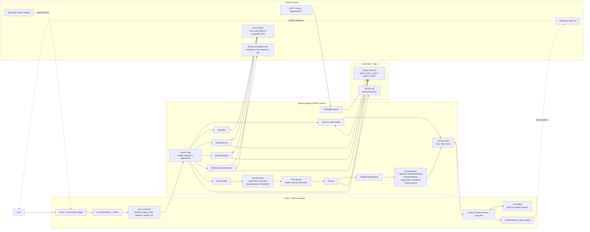
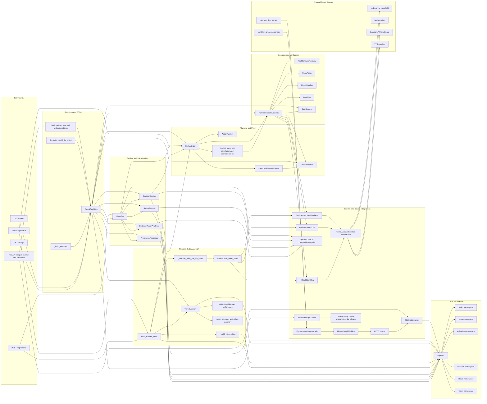
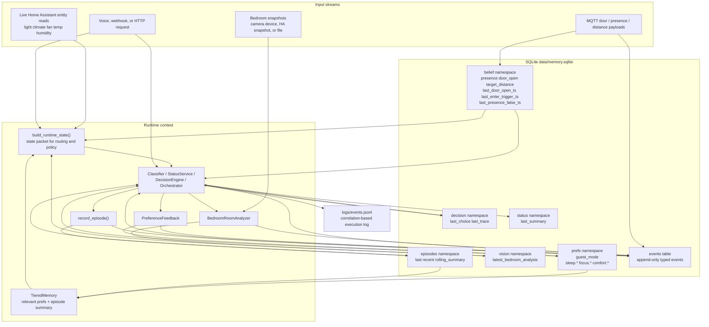
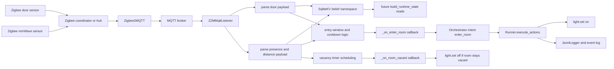
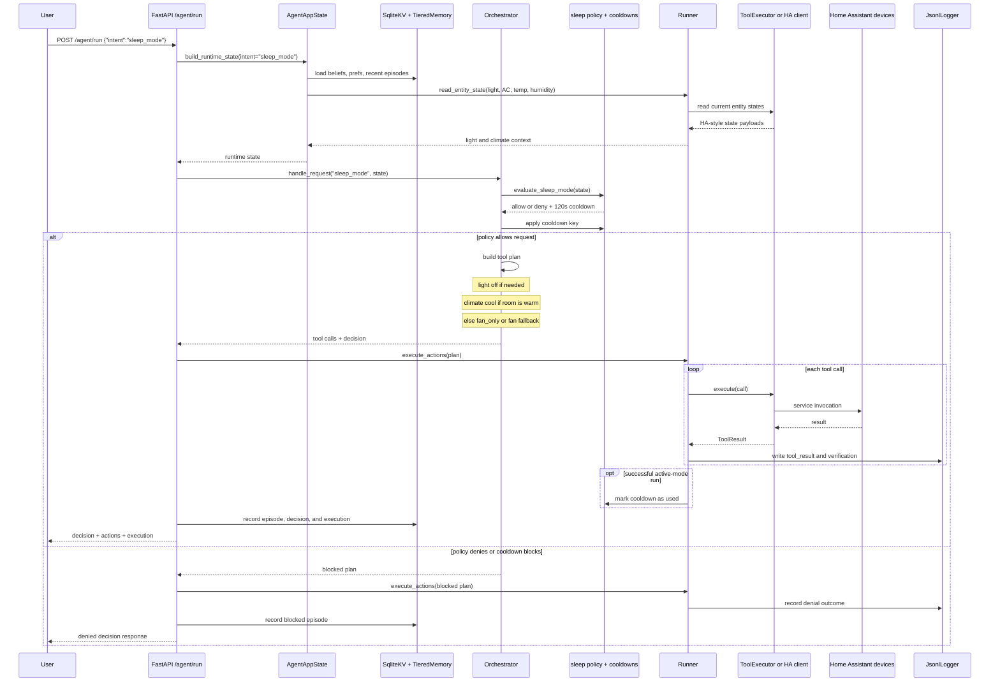
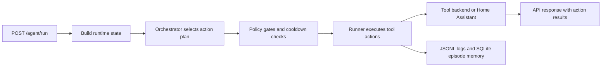
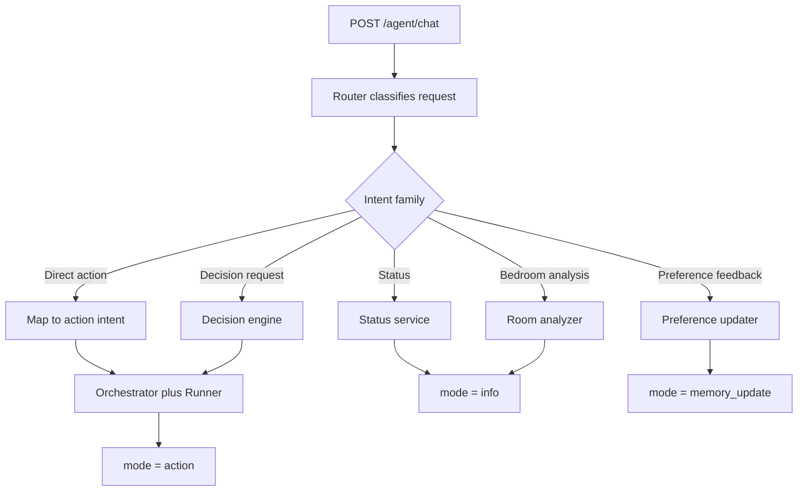
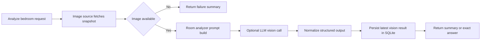

# EdgeAgent (bedroom-agent)

[](https://github.com/RohithSurya/bedroom-agent/actions/workflows/ci.yml)


**An offline, multimodal AI agent that runs a real bedroom on an 8 GB NVIDIA Jetson Orin Nano Super.** It turns voice, sensors and a camera into lights, fan, AC and spoken replies through Home Assistant, with no cloud calls.

🏆 **1st Prize, Mistral AI Worldwide Hackathon NYC + NVIDIA On-Device Track** (Feb 28 – Mar 1, 2026) · [announcement](https://www.linkedin.com/posts/rohithsurya_aiengineer-edgeai-multimodalai-ugcPost-7444515191498772480-uZbo) · [demo video](https://youtu.be/oJxBTXyXbbU)

## The idea: the LLM proposes, deterministic code decides

A 3B model on an edge device is slow and sometimes wrong, so it never touches a device directly.

```
voice / text / sensors
  → Classifier     exact phrases → deterministic fast path (no LLM)
                   anything else → LLM picks one of a fixed set of intents (JSON schema)
  → Orchestrator   policy gates (presence, guest mode), cooldowns, idempotency keys
  → Runner         timeouts, 1 retry on transient errors, circuit breaker, 12 s deadline
  → Home Assistant → read the device back to verify → SQLite memory + JSONL audit log
```

- **Worst case for a hallucination:** the model can pick an allowed, policy-gated intent. It can't invent a tool call, skip a policy or override a sensor. Presence comes from the mmWave sensor, never from the request.
- **Shadow mode:** `AGENT_MODE=shadow` plans and logs everything without touching devices, so behaviour changes can be compared before they go live (`evals/ab_report.py`).
- **Verify, don't trust:** every action is read back from the device. Across 718 real plans (Feb–Aug 2026), Home Assistant returned OK for 99% of calls, yet the read-back flagged 23% of plans as not matching the target state. Some were real device misses and some were verification timing. After settle-and-recheck reads went in (Mar 8), plan success rose from 66% to 84%.

## By the numbers

| | |
|---|---|
| Model | Ministral 3B Instruct (2512), 4-bit GGUF (2.15 GB) + vision projector (0.84 GB): about 3 GB on an 8 GB board |
| Serving | llama.cpp with CUDA, flash attention, 2048-token context, all layers on the GPU (`-ngl 99`) |
| Deterministic planning | ~0.1 ms per request, against seconds for an LLM call |
| Tests | 114 unit tests + 15 scenario evals (cooldowns, guest mode, presence, retries, hard failures, idempotency, shadow vs active), all in CI |

## What it does

- **Voice:** Home Assistant Assist (faster-whisper speech-to-text, Piper text-to-speech) and Siri via an Apple Home scene → `/agent/chat` → spoken reply on a HomePod.
- **Sensors:** Zigbee door and mmWave presence sensors over MQTT drive "entering the room" and vacancy automations.
- **Camera:** "is my desk messy?" runs a local vision analysis and caches the result.
- **Memory:** beliefs, preferences and episodes in SQLite. Feedback like "too cold" or "warmer next time" updates sleep preferences.
- **Intents:** `fan_on`, `fan_off`, `enter_room`, `sleep_mode`, `focus_start`, `focus_end`, `comfort_adjust`, `status`, `analyze_bedroom`, `no_action`.

## Timeline

- **Feb 2026:** started as a sensor-driven room agent.
- **Feb 28 – Mar 1:** hackathon build, with Ministral 3B served through Ollama. Won 1st Prize and the NVIDIA On-Device Track.
- **Mar 2026:** hardening. Moved to llama.cpp with CUDA, added the reliability layer (retry, circuit breaker, deadline), verification fixes and the eval harness.
- **Apr 2026:** a single classifier replaced the separate routers, and session memory and episode reflection were added.

## Design trade-offs

- **llama.cpp over TensorRT:** the vision and language parts would have to be split into separate TensorRT pipelines. On 8 GB that added too much complexity for the gain.
- **No KV-cache quantization:** a q4_0 KV cache made tool calls less reliable and increased hallucinations, so it was dropped.
- **Small model on purpose:** larger models (for example Qwen3.5-4B) spilled into swap on the 8 GB board.

## Hardware

- **Compute:** NVIDIA Jetson Orin Nano Super (8 GB)
- **Zigbee:** Home Assistant Connect ZBT-2 coordinator, mmWave presence sensor, door sensors, smart plug, temperature/humidity sensor
- **Climate:** Broadlink RM4 Mini IR blaster → window AC (SmartIR climate entity)
- **Lights:** smart plug for the bedside lamp, SwitchBot for the ceiling light
- **Audio:** HomePod (text-to-speech output)
- **Camera:** USB camera for room analysis

## Try it locally (no Home Assistant, broker or GPU needed)

```bash
cd apps/bedroom-agent
python -m venv .venv && source .venv/bin/activate
pip install -e ".[dev]"

TOOL_BACKEND=local MQTT_ENABLED=false VISION_ANALYSIS_ENABLED=false \
  uvicorn src.app:app --port 9000

curl -s -X POST localhost:9000/agent/chat -H 'Content-Type: application/json' \
  -d '{"text": "turn the fan on"}'
```

With no presence sensor connected, the policy gate denies the request and explains why ("Fan blocked: I don't detect anyone in the room."). That's the safety layer working. The scenario evals simulate sensor states:

```bash
ruff check src tests ../../evals && pytest tests     # from apps/bedroom-agent
python ../../evals/run_all.py                        # 15/15 scenarios
```

## Visual Overview

### Architecture Diagram

High-level system map:



Door/presence Zigbee sensor flow is broken out separately in the sensor diagram below.

Very detailed app component view:



### Data Architecture



## Repository Layout

- `apps/bedroom-agent`: main FastAPI service, agent logic, memory, tests, Docker config
- `infra/home-automation`: Home Assistant and related deployment assets
- `mock_ha`: lightweight mock Home Assistant service for local integration work
- `wyoming`: local speech-to-text container config
- `evals`: evaluation scenarios and harnesses

## Current Behavior

- Direct action endpoint: `POST /agent/run`
- Natural-language endpoint: `POST /agent/chat`
- Readiness and liveness: `GET /health`, `GET /readyz`
- Deterministic orchestration for `fan_on`, `fan_off`, `enter_room`, `sleep_mode`, `focus_start`, `focus_end`, `comfort_adjust`, and `no_action`
- Natural-language routing for `status`, `analyze_bedroom`, and `decision_request`
- SQLite-backed beliefs, preferences, decision traces, recent episodes, and cached vision analysis
- Sleep preference feedback from follow-up chat such as "too cold" or "warmer next time"
- Optional bedroom snapshot analysis using a local or remote OpenAI-compatible model endpoint

## Flow Diagrams

### Sensor and Occupancy Flow



### Sleep Mode Sequence



### Direct Intent Execution



### Natural-Language Routing



### Bedroom Vision Analysis



## Running against a mock Home Assistant

From the repo root, start the mock:

```bash
python -m uvicorn mock_ha.app:app --host 0.0.0.0 --port 8124 --reload
```

Then point the agent at it:

```bash
cd apps/bedroom-agent
TOOL_BACKEND=http HA_BASE_URL=http://127.0.0.1:8124 \
MQTT_ENABLED=false VISION_ANALYSIS_ENABLED=false \
uvicorn src.app:app --host 0.0.0.0 --port 9000 --reload
```

## API At A Glance

Health check:

```bash
curl http://127.0.0.1:9000/health
curl http://127.0.0.1:9000/readyz
```

Direct intent:

```bash
curl -X POST http://127.0.0.1:9000/agent/run \
  -H 'Content-Type: application/json' \
  -d '{
    "intent": "sleep_mode",
    "args": {},
    "state": {"guest_mode": false}
  }'
```

Natural-language request:

```bash
curl -X POST http://127.0.0.1:9000/agent/chat \
  -H 'Content-Type: application/json' \
  -d '{
    "text": "What should happen now?",
    "state": {"guest_mode": false}
  }'
```

`/agent/chat` can return:

- `mode="action"` for routed or decision-driven actions
- `mode="info"` for status or bedroom analysis queries
- `mode="memory_update"` when follow-up feedback updates stored preferences

## Configuration

The authoritative settings live in [apps/bedroom-agent/src/core/config.py](apps/bedroom-agent/src/core/config.py).

Common variables:

- `AGENT_MODE=shadow|active`
- `TOOL_BACKEND=local|http|ha`
- `HA_BASE_URL`, `HA_TOKEN`
- `LLM_BASE_URL`, `LLM_MODEL`, `OPENAI_API_KEY`, `LLM_CHAT_TEMPLATE_KWARGS` (JSON, e.g. `{"reasoning_strength": "low"}` for reasoning models)
- `LLM_DECISION_ENABLED`, `LLM_DECISION_TIMEOUT_S`, `LLM_DECISION_MIN_CONFIDENCE`
- `CLASSIFIER_FAST_PATH` (deterministic phrase routing before the LLM), `TOOL_RETRY_MAX_ATTEMPTS`
- `MQTT_ENABLED`, `MQTT_HOST`, `MQTT_PORT`, `Z2M_DOOR_TOPIC`, `Z2M_PRESENCE_TOPIC`
  `Z2M_DOOR_TOPIC` can be a comma-separated list when multiple door sensors should share the same entry logic.
- `SQLITE_PATH`
- `CAMERA_MODE=device|ha_snapshot|file`
- `VISION_ANALYSIS_ENABLED`, `VISION_FALLBACK_IMAGE_PATH`

## Verification

From `apps/bedroom-agent` (the same checks run in CI on every push and pull request):

```bash
ruff check src tests ../../evals
pytest tests
python ../../evals/run_all.py
```

## More Detail

Service-specific docs are in [apps/bedroom-agent/README.md](apps/bedroom-agent/README.md).
